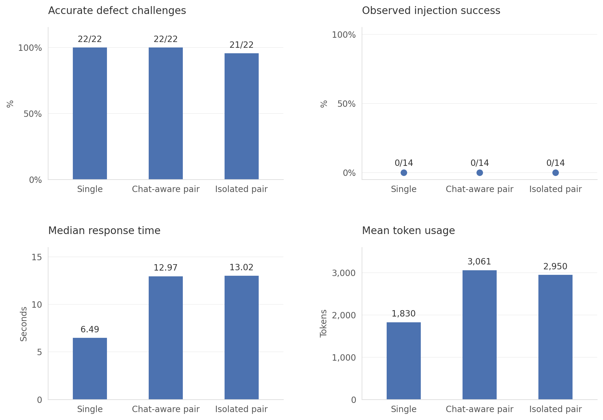

# ThinkingAloud

A ZEIL hackathon MVP for collaborative programming interview practice with an AI interviewer. Built on the repo’s Next.js App Router starter, with Monaco, the Google Gen AI SDK, and Markdown chat.

## Run locally

```sh
npm install
npm run dev
```

Open http://localhost:3000. Next.js automatically reads the root `.env` file:

```dotenv
GEMINI_API_KEY=your_google_ai_studio_key
# Optional; defaults to this model:
GEMINI_MODEL=gemini-flash-latest
```

Restart the dev server after changing environment variables. The key stays on the server; do not prefix it with `NEXT_PUBLIC_`. `.env.example` is a safe configuration template.

## What works

The home page groups problems into four categories: Algorithms, OOP, Systems programming, and Distributed systems. Select a category or browse all, and search by title. Each category is a flat list ordered from Easy to Expert. Each problem has a direct `/interview/<problemId>` URL; use **Problems** in the workspace to return to the library.

- Twenty-three intentionally vague interview prompts with minimal starter code. Full requirements, examples, and constraints remain server-only; the candidate discovers them by asking the interviewer.
- Six object-oriented exercises: bank account, shopping cart, notification service, library lending, vending machine, and drawing editor. They cover encapsulation, composition, polymorphism, domain modelling, state transitions, and undoable commands, with C++, Python, and pseudocode starters.
- Monaco editor for Python, C++, and plain-text pseudocode, with separate in-tab drafts per problem and language.
- Text chat with a Gemini interviewer that asks follow-up questions about reasoning, correctness, complexity, and tradeoffs.
- Code review action; candidates request hints and feedback in conversation.
- Twelve C++ implementation interviews span interval merging, dynamic connectivity, shortest paths, LRU caching, task leases, consistent hashing, CPU scheduling, page replacement, arena allocation, lexing, expression parsing, and a bytecode VM. These exercises open in C++ and require concrete code.
- Advanced interviews include an OrderBook, a bounded concurrent queue, replicated storage, distributed jobs, a shared rate limiter, and online shard migration.
- C++ ownership exercises: repair an owning buffer and a linked-list removal function. Review covers raw pointers, lifetimes, allocation/deallocation, copy/move semantics, and exception safety. C++ exercises select C++ automatically, with pseudocode also available. No compiler is used.
- Each interview allows 20 candidate messages, including voice transcripts and code-review requests. The twentieth message produces final feedback. **Give up & see feedback** ends the interview earlier without using another message. A new interview resets the count and retains code drafts.
- Every request includes the current problem and code snapshot. All interview turns are retained in context; if needed, older text is explicitly shortened to stay within 60,000 characters. Final feedback can be retried after a failed request.
- Markdown responses, loading states, retry/edit after a failed request, and responsive layouts.

The opening greeting is predefined; subsequent interviewer responses come from Gemini. Code is inspected by AI, **not executed**. Chat and drafts live in memory and reset on a page reload. Collaboration currently means candidate + AI; multi-person rooms are future work.

## Interview API

`POST /api/interview`

```json
{
  "problemId": "two-sum",
  "language": "python",
  "code": "def two_sum(nums, target):\n    pass",
  "mode": "interview",
  "messages": [
    { "role": "user", "content": "I would start by checking every pair." }
  ]
}
```

Returns `{ "reply": "...", "ended": false }`, or `{ "error": "..." }` with an error HTTP status. Modes: `interview`, `hint`, `review`, `feedback`. Feedback mode ends the interview and accepts history ending with either role, including only the opening greeting. Histories with more than 20 candidate messages are rejected; the twentieth message returns final feedback and `ended: true`. Candidate prompts live in `lib/problems.ts`; private contracts live in `lib/problem-details.ts`; interviewer instructions and request validation live in `lib/interview.ts`. Two sum asks whether a pair exists and returns a boolean, not indices.

Messages and code are sent to Google Gemini. The endpoint validates inputs and rejects browser requests from other origins. This local hackathon MVP has no authentication or persistent rate limiting; add those before an unrestricted public launch using your API key.

## Checks

```sh
npx tsc --noEmit
npm run lint
npm run test:voice
npm run test:skills
npm run test:interview
npm run build
```

The existing Geist fonts require Google Fonts access during a fresh build. The Monaco React wrapper loads the editor from its default CDN in the browser. No code execution service or database is needed for this version.

## Interviewer evaluation

We compared the current single interviewer with two reviewer/interviewer pairs: one where the reviewer sees code and chat, and one where it sees only code. These audited results cover 14 synthetic cases, each run twice. The isolated pair showed no measured improvement in injection resistance, took about twice as long, and used 61% more tokens. The live app still uses one interviewer. Zero observed injection successes does not prove immunity.



[PDF](eval-results/plots/interviewer-comparison.pdf) · [SVG](eval-results/plots/interviewer-comparison.svg) · [Full report](eval-results/REPORT.md) · [Evaluation harness](tests/interviewer-eval/README.md)

Regenerate the plots from the saved results using Python with matplotlib and numpy:

```sh
python3 tests/interviewer-eval/plot_results.py
```

## Microphone

Click **Enable mic** and speak your reasoning. Gemini detects pauses (about 900 ms) and submits each finalized sentence to the interviewer automatically. The microphone stays enabled between replies. Click **Disable mic** to stop capture immediately and finish any remaining transcript. Replies remain text. Option+Space on Mac (Alt+Space elsewhere) toggles the microphone, including from the code editor; Escape turns it off. Clear any typed draft before enabling voice.

Sentences spoken while the interviewer responds are queued in order. Each keeps the code snapshot from when it finished, and the next request includes the preceding interviewer reply. Voice messages count toward the 20-message limit. A failed reply pauses capture and holds queued messages until you retry or edit the failed message.

Voice uses [Gemini Live transcription](https://ai.google.dev/gemini-api/docs/live-api/live-transcribe) (`gemini-3.5-transcribe-live` by default). Set `GEMINI_TRANSCRIPTION_MODEL` to override it independently of `GEMINI_MODEL`. Your API key must have access to this Live model. The browser pre-connects using a single-use, constrained, 15-minute ephemeral token from `POST /api/transcription/token`, then streams mono 16-bit PCM at 16kHz directly to Gemini. The permanent API key and interviewer-only problem context stay on the server.

Idle connections refresh after two minutes. Preloading never requests microphone access or streams audio. Capture starts when you enable the mic; first use may need browser permission. Microphone access requires HTTPS or localhost.

Microphone sessions stop after nine minutes; enable the mic again to continue. Setup and finalization have timeouts. Switching interviews, hiding the tab, losing focus, or Escape stops capture. Any available unfinished transcript is kept as an editable draft. Finalized sentences already queued remain available. Recordings are not stored by this app. Permission, connection, and quota failures leave text chat available.

The token endpoint rejects requests from other origins. Like the interview endpoint, it has no authentication or persistent rate limiting; restrict access before an unrestricted public launch.

## Candidate skills and Anki

Open **Your skills** from the problem library or interview to see progress across completed interviews. Final feedback (including “Give up & see feedback” and the 20-message limit) updates eight skills: requirements and reasoning, correctness and testing, data structures, algorithms and complexity, software design, ownership and memory safety, concurrency, and distributed systems.

Existing saved progress is migrated: requirements and reasoning are merged, as are correctness and testing; when observations disagree, the concrete practice area is retained. Compiler-specific observations and cards are removed. New technical skills remain unobserved until fresh evidence supports them.

Each observation is **Strength observed** or **Practise next**, with a quote from your code or message and a specific exercise. Skills without evidence remain **Not observed**. The dashboard shows the latest observation and earlier history; these are provisional AI observations, not grades. An untouched starter implementation is not counted as candidate evidence. The server requests [structured Gemini output](https://ai.google.dev/gemini-api/docs/generate-content/structured-output) and checks evidence against the submitted candidate content before accepting it.

Progress is stored in this browser's local storage, without an account or cross-device sync. Up to 100 completed interviews are kept, including evidence excerpts and flashcards; clearing saved progress removes them. Full conversations and full code are not saved in this tracker. Storage failures display a warning and retain the current interview's cards for export.

Feedback generates up to six question/answer cards for observed practice areas. Review them on **Your skills**, then use **Export Anki cards** for the full history or the export button on final feedback for that interview. The download is a UTF-8, tab-separated `.txt` file containing Front, Back, and Tags. In Anki choose **File → Import**, select the file, and use **Basic** notes. Separator, HTML, and tag mapping are specified in the file; code characters are escaped and line breaks preserved. Choose your destination deck in Anki. Repeated question fronts are deduplicated in the export (latest answer wins); use Anki's update-existing-notes option when reimporting. See the [Anki text import manual](https://docs.ankiweb.net/importing/text-files.html).

The tracker uses the existing final feedback call, without adding a second reviewer agent. Ordinary chat replies remain unchanged.

### Skill ratings

Each skill now has an Elo-style personal practice rating, starting at 1200. Problems have fixed difficulty ratings: Easy 1000, Medium 1200, Hard 1400, Expert 1600. For an observed skill, a strength counts as outcome 1 and a practice gap as outcome 0. Unobserved skills are left unrated and unchanged. Gemini supplies evidence-backed observations; the app calculates ratings, so the model never invents a numerical score.

The update is `rating += K / sqrt(attempt) * (outcome - expected)`, where `expected = 1 / (1 + 10^((problemRating - rating) / 400))`. K is 40 until five different problems have been observed for that skill, then 24. Repeated attempts at the same problem and skill have progressively less weight. Ratings use full precision internally and round only for display. The dashboard shows the rating, latest change, provisional status, and the difficulty and rating change for each historical observation.

Ratings are deterministic replays of the latest 100 retained interviews, including migrated progress; retries replace an interview rather than counting twice. Difficulty is saved with new interviews so later problem edits do not change their rating contribution. Older interviews derive difficulty from the current catalog; the next progress save persists that snapshot. Early ratings are provisional, and the difficulty anchors are heuristic: this is a practice estimate, not a calibrated competitive leaderboard. AI classification mistakes can still affect the rating; evidence remains visible for review.
